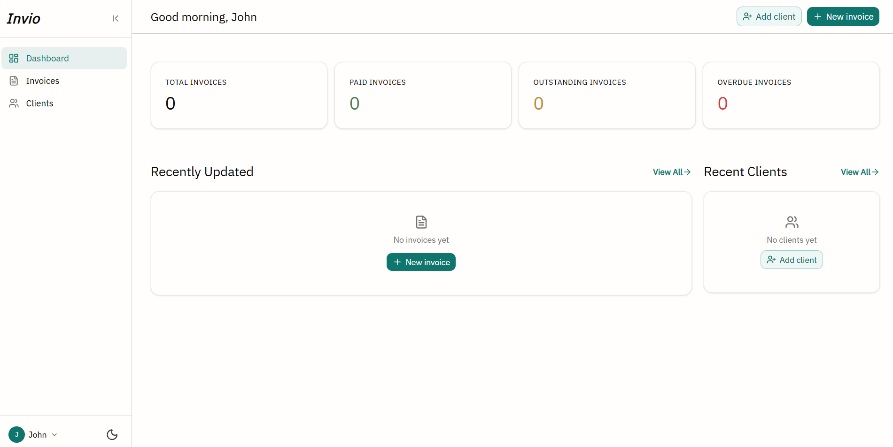
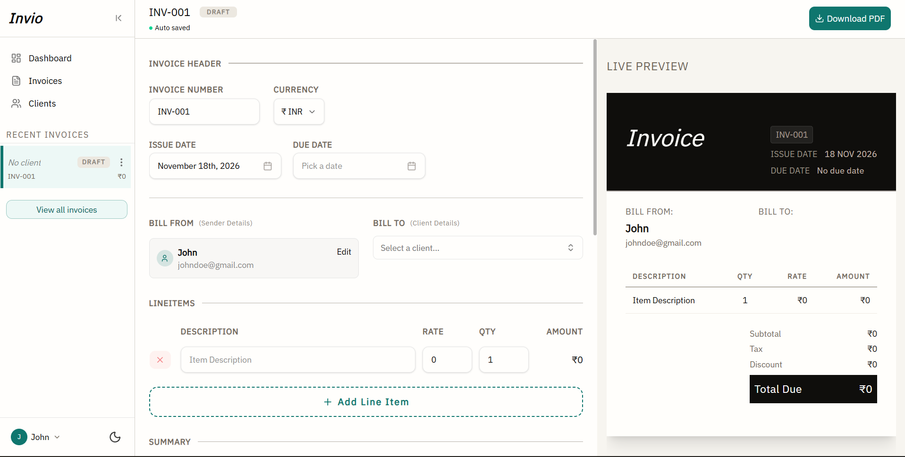

# Invio - Invoice Generator

A full-stack invoice management app. Create invoices with a live preview, manage clients, autosave drafts, and export polished PDFs.

**[Live Demo](https://invio-eight.vercel.app)**

## Preview




---

## Features

- Authentication - register and log in with JWT stored in an httpOnly cookie. Account deletion requires password verification.
- Invoice editor - form and live preview side by side, with automatic subtotal, tax, and discount calculation.
- Autosave - drafts save to the backend 2 seconds after you stop typing, with a live save-status indicator.
- Invoice lifecycle - Draft, Sent, Paid, and Cancelled statuses, and overdue detection. Only drafts are editable; everything else is locked.
- Client directory - search clients by name or email while creating an invoice, or create one on the spot.
- Dark / Light Mode - toggle between themes.
- PDF export - download invoices as PDFs, currently generated in the browser with @react-pdf/renderer

---

## Tech Stack

- Frontend - React, TypeScript, Vite, Tailwind CSS, shadcn/ui
- State and data - TanStack Query (server state), Zustand (app and auth state), Axios
- Forms - React Hook Form, Zod
- PDF - @react-pdf/renderer
- Backend - Node.js, Express, TypeScript, Zod
- Database - PostgreSQL (Neon), Prisma
- Auth - JWT in httpOnly cookies, bcrypt
- Hosting - Vercel (frontend), Render (backend), Neon (database)

---

## Architecture

The frontend proxies /api/\* requests through Vercel to the Render backend. The browser only talks to one origin, so the auth cookie stays first-party and no cross-site cookie or CORS workarounds are needed.

Data flow on the frontend:

**TanStack Query** owns everything fetched from the API.

**React Hook Form** owns the in-progress invoice form and populates live preview.

**Zustand** manages client-side application state, split into an appStore (theme and UI state) and an authStore (current user, authentication status, and authentication-related actions).

---

## Installation & Setup

```bash
# Clone the project
git clone https://github.com/Anurag2516/invio-invoice-generator

# Navigate to project folder
cd invio-invoice-generator
```

- Backend

```bash
# Install dependencies
cd backend
npm install

# Create backend/.env
DATABASE_URL= Your PostgreSQL database URL
JWT_SECRET_KEY= Generate a secret key(node -e "console.log(require('crypto').randomBytes(32).toString('hex'))")
FRONTEND_URL="http://localhost:5173"
NODE_ENV="development"

# Run migrations and start the server
npx prisma generate
npx prisma migrate dev
npm run dev
```

- Frontend

```bash
# Install dependencies
cd frontend
npm install

# Create frontend/.env
VITE_API_URL="http://localhost:3000"

# Start the server
npm run dev
```

---

## Roadmap

- Send invoices - email an invoice to the client directly from the app, with the status moving from Draft to Sent automatically.

- Backend PDF generation - PDFs are currently rendered in the browser with @react-pdf/renderer. Generating them on the server will give consistent output across devices and let the same PDF be attached to emailed invoices.

---

## Design Decisions

**Snapshot pattern for invoices**. An invoice is a legal record, so client and sender details are frozen on it at creation. The clientId keeps a live link back to the client record without affecting what the invoice shows.

**Autosave instead of local persistence**. The backend is the single source of truth, so a reload, a closed tab, or a different device all pick up exactly where you left off.

**Locked non-draft invoices**. Once an invoice is sent, it can't be silently changed.

**Proxy over cross-site cookies**. Routing API calls through the frontend domain avoids third-party cookie blocking in modern browsers.

---

## License

This project is licensed under the MIT License - see the LICENSE file for details.
